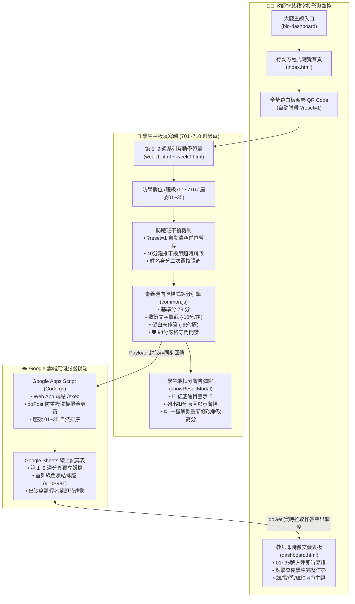

# 🌱 桃園市楊光國中 115 學年度【行動方程式】專案架構與維護總手冊
> **專供教師存檔、新進 AI 快速接手與跨會話即時導航之用**  
> **建立日期**：2026 年 11 月 9 日 | **版本**：v2.5 (旗艦終極版)

---

> [!IMPORTANT]
> **給新開對話視窗的 AI Agent 指令（交接導航咒語）**：  
> 當教師在新的聊天對話中告知：  
> `「請讀取 D:\antigravity\彈性課程【行動方程式】\【行動方程式】專案架構與維護總手冊.md」`  
> 請立即研讀本文件，遵循本手冊之**「單元架構」**、**「素養階梯評分規準」**、**「94分嚴格守門機制」**、**「GAS後端與試算表規範」**及**「GitHub Pages 部署路徑」**，嚴禁擅自更動檔案路徑或放寬評分標準。

---

## 🧭 一、 核心線上入口與遠端倉庫速查卡

| 服務項目 | 類型 | 官方網址 / 路徑 | 說明與注意事項 |
| :--- | :---: | :--- | :--- |
| 🚀 **學習單主平台** | 學生端 | [https://zeroseven-hue.github.io/action115/](https://zeroseven-hue.github.io/action115/) | 第 1～9 週互動學習單入口、大螢幕派卷 QR Code |
| 📊 **教師即時儀表板** | 教師端 | [https://zeroseven-hue.github.io/action115/dashboard.html](https://zeroseven-hue.github.io/action115/dashboard.html) | 01~35 號九宮格即時繳交狀況、出缺席連動、4色主題 |
| 📋 **線上成績試算表** | 資料庫 | [Google Sheets 成績試算表](https://docs.google.com/spreadsheets/d/1aPvaTbgy5vCoDpTfDgCTZGs4WedeT1w96W7gPaXGyL0/edit) | 試算表 ID: `1aPvaTbgy5vCoDpTfDgCTZGs4WedeT1w96W7gPaXGyL0`<br/>第 1~9 週工作表分頁、綠色凍結首列排版 |
| 🏛️ **大廳五總控台** | 總導覽 | [https://zeroseven-hue.github.io/bio-dashboard/](https://zeroseven-hue.github.io/bio-dashboard/) | 整合生物測驗、段考檢討、正課與行動方程式總入口 |
| 💻 **本機網頁庫路徑** | 本地端 | `D:\antigravity\彈性課程【行動方程式】\web_learning_sheets\` | GitHub 倉庫本機工作目錄 (分支: `main`) |
| 📦 **GitHub 遠端庫** | 原始碼 | `https://github.com/zeroseven-hue/action115.git` | 網頁靜態部署庫 (GitHub Pages 託管) |
| 🌐 **GAS 雲端暗管** | API 端點 | `https://script.google.com/macros/s/AKfycbyzDaKcAxAxvSKOqaXM0pF6H3uugLAs6FkE_OPbwVyaSpqQWxmNhb7JQBqLJXnTLZkWog/exec` | ⚠️ 結尾必須為 `/exec`，嚴禁使用 `/dev` |

---

## 🗺️ 二、 系統全景架構圖



---

## 📚 三、 課程 1～9 週教材實體路徑與單元對照表

所有教材（Word 教案、Word 學習單、16:9 PPT 簡報）均存於本機實體資料夾：  
根目錄：`D:\antigravity\彈性課程【行動方程式】\`

| 週次 | 單元主題名稱 | 本機實體教材目錄 | 網頁版檔案 | 核心學習任務與評量重點 |
| :---: | :--- | :--- | :--- | :--- |
| **01** | 美麗的海岸線——還原自然 | `【行動方程式】第 1 週：美麗的海岸線——還原自然\` | `week1.html` | 海洋廢棄物統計、ICC 淨灘分類、治標 vs 治本源頭減塑分析 |
| **02** | 美麗的海岸線——台灣海底垃圾 | `【行動方程式】第 2 週：美麗的海岸線——台灣海底垃圾\` | `week2.html` | 海底沉積廢棄物 (廢棄刺網/輪胎)、生態衝擊、潛海戰將與源頭解方 |
| **03** | 環保無國界——雨林·生存臨界點 | `【行動方程式】第 3 週：環保無國界——雨林·生存臨界點\` | `week3.html` | 消失的國界專題、亞馬遜雨林砍伐危機、生態服務價值與碳排溫室效應 |
| **04** | 環保無國界——雨林·生存臨界點 (探究篇) | `【行動方程式】第 4 週：環保無國界——雨林·生存臨界點\` | `week4.html` | 原住民捍衛土地環境正義、日常生活隱形殺手 (棕櫚油/飼料大豆)、RSPO 永續消費 |
| **05** | 地球公民——環境保育一起來 | `【行動方程式】第 5 週：地球公民——環境保育一起來\` | `week5.html` | 世界地球日/環境日由來、各國綠色創新案例資訊統整、小組角色明確分工 |
| **06** | 地球公民——環境保育一起來之『發表會』 | `【行動方程式】第 6-7 週：地球公民——環境保育一起來之『發表會』\` | `week6.html` | 小組成果發表展示、同儕聆聽反饋亮點、個人發表會總結省思與生活實踐宣言 |
| **07** | *(段考彈性緩衝週)* | *(同第 6-7 週資料夾)* | `week7.html`<br/>*(自動跳轉 week6)* | 因應各班段考進度不同，6 與 7 週發表會彈性合併跨週進行 |
| **08** | 還我安靜的環境——噪音對生態環境的影響 | `【行動方程式】第 8 週：還我安靜的環境——噪音對生態環境的影響\` | `week8.html` | 水下音速 (1500m/s)、人為噪音源 (離岸風電/船隻)、聲學遮蔽、氣泡帷幕減噪解方 |
| **09** | 還我安靜的環境——噪音對生態環境的影響之『分享會』 | `【行動方程式】第 9 週：還我安靜的環境——噪音對生態環境的影響之『分享會』\` | `week9.html` | 噪音研究專題分享、跨組思辨提問、個人與海洋生活寧靜宣言 |

---

## 🎯 四、 智慧素養階梯評分規準與防禦機制 (Scoring Engine)

系統由 `assets/js/common.js` 的 `evaluateUnitWorksheet(weekId, answers)` 進行核心運算：

### 1. 分數帶級距設計
* **基礎完備分**：**78 分**（基本資料填寫齊全、正常完成作答之起步分）。
* **一般正常作答落點**：**80 ～ 88 分**（有答出重點、符合字數要求）。
* **良好優質作答落點**：**88 ～ 92 分**（切中核心關鍵字、敘述具體）。
* **特優深入作答落點**：**93 分**（命中多個核心概念關鍵字且論述充實）。
* **🛡️ 嚴格守門門禁（94 分天花板）**：
  > 除非該單元「每一道問答題皆達到特優深入水準」，且「全程零扣分」，系統總分才允許突破 94 分至 100 分；否則一律強制封頂於 **93 分**！

### 2. 🚨 嚴格懲罰與敷衍攔截機制
* **敷衍/同儕語音贅詞扣分**：每題**扣 -10 分**！
  * 偵測演算法 `checkIsNonsense(rawText)`：
    1. 偵測連續重複 3 次以上字符（如 `高高高`、`？？？`、`喔喔`、`誒誒`）。
    2. 偵測長度 $\ge 8$ 但相異字元比例極低之亂碼。
    3. 命中同儕閒聊/敷衍黑名單（如 `快去誒一下手機看猜誰喔喔`、`給給高`、`不知道`、`隨便`、`哈哈`、`笑死`）。
* **空白留白未作答**：每題**扣 -5 分**！

### 3. 🚨 學生端即時警惕彈窗 (`showResultModal`)
若評量結果包含任何扣分項目：
1. 彈窗圖示轉為閃爍警報燈 `🚨`。
2. 標題紅字警示：**「學習單已送出（初評含扣分警告）」**。
3. 成績欄位轉為紅底警示方塊。
4. 正下方跳出紅框警告卡，逐一列出扣分題目與原因。
5. 明確提示：**「老師已在後台儀表板同步檢視您的完整作答，請立即重新修改訂正以免影響平時成績！」**
6. 提供橘色專屬按鈕：**`✏️ 立即重新修改作答（消除扣分爭取高分）`**。

### 4. 🔄 防重複交卷提示
若學生在同一台平板上已經繳交過，再次按下送出時會主動跳出覆核視窗：
> *「您之前已提交過第 X 週學習單（得分：XX 分）。確定要以本次修改的最新內容覆蓋先前的成績送出嗎？」*

---

## 💻 五、 跑班平板車防干擾機制 (Tablet Cart Defense)

國中智慧教室平板多採「跑班流動推車」使用，為防止下節課學生讀取或覆蓋前一位同學的資料，系統建立了三道防線：

1. **二維碼派發自動清空 (`?reset=1`)**：
   * 教師在 `index.html` 產生白板投影派卷 QR Code 時，網址自動附加 `?reset=1`。學生掃碼後會自動銷毀平板上的上一筆暫存。
2. **40 分鐘推車換節超時銷毀 (`checkSessionTimeout`)**：
   * 系統自動比對上次編輯時間戳記，若超過 40 分鐘（剛好一節課），判定已換班，自動清空本機舊草稿。
3. **身分二次覆核彈窗 (`showIdentityVerifyModal`)**：
   * 若平板留有前次紀錄，開啟時會跳出大字卡確認身分：
     > *「本平板目前留存 702 班 23 號 白芸瑄 同學的紀錄。請問這是你嗎？」*  
     > 提供綠色「是我，繼續作答」與紅色「不是我，我是新同學（清空開新卷）」按鈕。

---

## ☁️ 六、 Google Apps Script 後端維護指南 (`gas/Code.gs`)

### 1. Google 試算表規格
* **試算表 ID**：`1aPvaTbgy5vCoDpTfDgCTZGs4WedeT1w96W7gPaXGyL0`
* **工作表分頁規範**：
  * `第1週作答紀錄` 至 `第9週作答紀錄`
  * `出缺席記錄`（存放各週各班之請假名單與應到人數）
* **欄位排版標準（比照第 3 週樣式）**：
  * 首列標題背景：`#10B981` (綠色)，文字白色粗體，固定置中，凍結第 1 列。
  * 座號固定補零為兩位數：`01` ～ `35`。
  * 每筆新提交資料寫入後，自動依「班級 (正序) ➔ 座號 (正序)」重新排列，方便教師登記。

### 2. Google Apps Script 部署注意
> [!CAUTION]
> 1. 在 GAS 編輯器中修改 `Code.gs` 後，必須點選：  
>    **「部署」➔「管理部署作業」➔「編輯」➔「版本：建立新版本」➔「部署」**。  
> 2. 「誰可以存取 (Who has access)」**必須維持「所有人 (Anyone)」**。  
> 3. 網址結尾必須是 **`/exec`**，絕對不可使用 `/dev`（否則會產生 CORS 跨來源阻擋或直接輸出 raw JSON）。

---

## 🛠️ 七、 日常維護與快速指令清單

### 1. 執行全專案自動化測試驗證
若日後有修改題目或調整規準，請在終端機執行測試腳本，確保無語法錯誤：
```powershell
# 切換至網頁目錄
cd "D:\antigravity\彈性課程【行動方程式】\web_learning_sheets"

# 語法驗證
node -c "assets/js/common.js"
```

### 2. 更新並推送至 GitHub Pages 發布
```powershell
cd "D:\antigravity\彈性課程【行動方程式】\web_learning_sheets"

# 檢查檔案狀態
git status

# 提交並推送
git add .
git commit -m "update: 更新學習單內容與評分規準"
git push origin main
```

---

## 📊 九、 教師即時儀表板、同號衝突一鍵裁決與自動更新技術規範 (2026 最新旗艦版)

針對實際課堂走動教學、大螢幕投影即時監看，儀表板已全數升級為**「5 秒即時輪詢 ✕ 學生姓名保全 ✕ 方案 B 一鍵座號轉移」**架構：

### 1. ⏱️ 5 秒即時自動同步機制 (`AUTO_REFRESH_INTERVAL_SECONDS = 5`)
* **5 秒倒數晶片**：右上角醒目顯示 `🟢 即時同步 5s`，秒數即時跳動（`5s ➔ 4s ➔ 3s ➔ 2s ➔ 1s ➔ 抓取最新資料`）。
* **自主開關控制**：點擊該晶片即可立即切換為 `⏸️ 暫停同步`，系統 0 負擔停止後台輪詢；再次點擊立即恢復倒數。
* **靜默背景更新**：輪詢在背景安靜執行，不跳出全螢幕遮罩或轉圈干擾。
* **防打擾鎖定**：老師在點開學生作答詳情彈窗、手動補登或門禁密碼解鎖時，計時器**自動凍結暫停**，絕不干擾老師閱讀或輸入。

### 2. 🛡️ 學生真實姓名絕對保全原則（試算表端零覆蓋鐵則）
* **姓名是唯一的真實身分憑證**：學生在平板上容易因誤選或手滑劃錯班級或座號（例如 705 劃成 706，或 15 號劃成 10 號）。
* **後端 `Code.gs` 防呆寫入**：
  * 若同座號已有資料，但**姓名不同**：**【絕對不覆蓋原同學】，強制使用 `appendRow` 新增獨立一列！**
  * 只有同班級且「姓名完全相同」時，才判定為該生本人重交或提升分數，進行原地更新。
  * 確保試算表 100% 留存兩位同學的原始紀錄，不抹銷任何心血。

### 3. ⚖️ 同號衝突偵測與【方案 B 一鍵裁決轉移】機制（教師免開試算表）
當有兩位以上不同姓名的學生誤劃同一個座號時：
1. **大螢幕矩陣卡片一眼看清**：
   * 該座號卡片自動亮起 **琥珀橘呼吸警示燈**。
   * 顯示兩位學生姓名：`⚠️ 陳品謙 / 林小美`，狀態顯示：`<span class="seat-conflict-badge">⚠️ 衝突 (2人)</span>`。
2. **點開彈窗即時身分比對**：
   * 彈窗左右並列呈現兩位同學姓名、時間、組別、得分與作答摘要。
   * 每位同學下方提供兩顆乾淨按鈕：`[ 👑 確認為本號 ]` 與 `[ 🔄 改移至正確座號 ]`。
3. **一鍵改移座號（3 秒歸位）**：
   * 老師直接點擊誤劃同學（如林小美）下方的 `[ 🔄 改移至正確座號 ]`，輸入正確座號（如 `15`）按確定。
   * **前端即時生效**：10 號立刻還給陳品謙（綠色已完成），15 號立刻亮起林小美（綠色已完成）。
   * **後台自動同步試算表**：前端自動發送 `action: "reassignSeat"` 到 Google Apps Script，後端自動更新該列座號為 `'15` 並重新排序。**老師完全不用登入 Google 雲端硬碟手動改！**

### 4. 🏆 100% 全班全齊檢核與未交名單通報
* **全齊醒目徽章**：當全班實到學生全數繳交（進度條達 100%）時，進度條右側自動亮起大徽章：
  👉 `100% [🎉 全班到齊全數繳交！]`，讓老師下課前抬頭一眼即知收齊了沒。
* **一鍵複製未交名單聯動**：點擊「📋 複製未交名單」時，若當下有同學誤劃同號，自動附註：
  `• ⚠️ 誤劃同號待確認：10 號 (陳品謙、林小美)`，便利班級群組或聯絡簿通報。

---

## 🚀 十、 未來新單元擴充與修改標準 SOP (How-To Guide)

未來若需要新增新週次（例如第 10 週）或新題型，請遵循下列三端同步擴充 SOP：

### 步驟 1：本機教材與網頁製作
1. 在實體目錄新增單元資料夾：`【行動方程式】第 10 週：XXXXX\`（放入 Word 教案、學習單、16:9 簡報）。
2. 在 `web_learning_sheets\` 複製 `week8.html` 為 `week10.html`，依單元內容修改題目 ID 與輸入欄位。
3. 在 `index.html` 的派發下拉選單與總覽卡片加入第 10 週入口。

### 步驟 2：素養階梯評分規準加入 (`common.js`)
在 `assets/js/common.js` 的 `evaluateUnitWorksheet(weekId, answers)` 中新增 `case '10':`：
* 設定基準分 78 分。
* 針對填空題定義精確正解（每答對加分）。
* 針對問答題加入關鍵字核心概念陣列 (`keywords`)、論述長度獎勵、敷衍攔截 (`checkIsNonsense`)。
* 守門規則：未全部答對且論述完整前，強制封頂於 93 分。

### 步驟 3：儀表板與試算表同步 (`dashboard.html` & `Code.gs`)
1. 在 `dashboard.html` 的週次下拉選單新增 `<option value="10">第 10 週 (XXXXX)</option>`。
2. 學生送出時，`Code.gs` 會自動在 Google 試算表建立分頁 `第10週作答紀錄`，並自動套用綠色凍結首列與自然數排序。

---

## 🧙‍♂️ 十一、 跨對話交接快捷指令句 (Copy & Paste)

下一次當您在新對話視窗開啟交接時，只需複製並貼上下方這段指令，AI 即可 100% 繼承所有脈絡：

```text
請先研讀檔案：D:\antigravity\彈性課程【行動方程式】\【行動方程式】專案架構與維護總手冊.md
請嚴格遵守該手冊所載之「115學年度七年級行動方程式」所有規範，包括：
1. 學生端作答與教師儀表板的正確網址與路徑；
2. 基準分78分、敷衍-10分、留白-5分、94分嚴格守門機制；
3. Google Sheets (1aPvaTbgy5vCoDpTfDgCTZGs4WedeT1w96W7gPaXGyL0) 與 GAS /exec 部署規範；
4. 跑班推車 ?reset=1 防干擾機制與 GitHub Pages main 分支推送 SOP；
5. 教師儀表板 5 秒即時輪詢、學生姓名保全零覆蓋、同號衝突方案 B 一鍵座號轉移與試算表雙向同步規範。
研讀完畢後，請向我簡要回報你已掌握重點，並等待我的下一步指示。
```

---
*本文件已永久存放於本機目錄：`D:\antigravity\彈性課程【行動方程式】\【行動方程式】專案架構與維護總手冊.md`*
